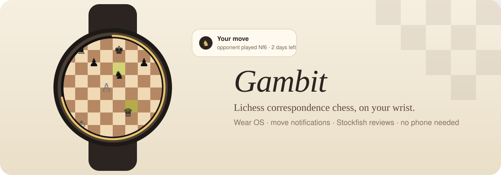
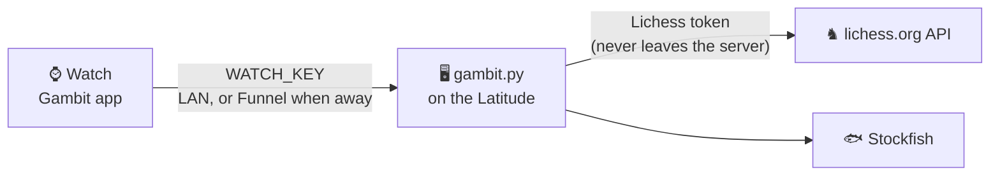

<p align="center">
  
</p>

<p align="center">
  <a href="https://gambit.rusty.is-a.dev/"><b>Website</b></a> ·
  <a href="#features">Features</a> ·
  <a href="#how-its-built">How it's built</a> ·
  <a href="#setup">Setup</a>
</p>

<p align="center">
  
  
  
  
</p>

---

> *Correspondence chess is the slow kind: days per move, not minutes.
> Which makes it perfect for a watch. Glance, think on it over lunch, move.*

**Gambit** puts your [Lichess](https://lichess.org) correspondence games on a
Wear OS watch. A buzz when your opponent moves, the board in your own Lichess
theme, and tap a piece, tap a square, confirm. It runs standalone over Wi-Fi,
so your phone can stay in your pocket (or at home).

## Features

<table>
<tr><td valign="top" width="50%">

### ♟️ Playing
- Your games, **your move first**, with time left on each
- Board and pieces in **your Lichess theme**, any piece set
- Taps **snap** to the nearest movable piece or legal square
- Bezel zooms, drag pans, **every move is confirmed**
- Promotion picker, draw offers, resign (confirmed), move list
- In-game chat with quick replies or voice

</td><td valign="top" width="50%">

### 🔔 Staying in the loop
- Notifications: opponent moved, game started or over, challenges
- **Five complications**: your-move count, most urgent game with a
  live countdown, clock ring, daily puzzle, correspondence rating
- Challenges: accept, decline, challenge a friend, or post an open seek
  (1 to 14 days per move)
- Friends with online status, profiles, follow, notes, DMs

</td></tr>
<tr><td valign="top">

### 🧩 Daily puzzle
Solve Lichess's puzzle of the day on your wrist. The result counts toward
your puzzle rating, and the complication gets a ✓.

</td><td valign="top">

### 🔍 Stockfish review
Finished games get a full review on the server: accuracy, inaccuracies,
mistakes and blunders, each shown on a board with the move you played (red)
and the best move (green). **Games still in progress are refused.** Fair play.

</td></tr>
</table>

## How it's built



Two halves:

- **`app/`**: the Wear OS app, Kotlin and Compose for Wear OS. Release builds
  only; debug builds are far too slow on a watch.
- **`server/gambit.py`**: a small server that **holds the Lichess token** so
  the watch never sees it. It watches the Lichess event stream for
  challenges and game starts, polls your ongoing games to spot opponent moves,
  validates moves with `python-chess`, and drives Stockfish for reviews. The
  watch talks only to this server, with its own key compared in constant time.

Piece sets other than the built-in *cburnett* are rendered to PNGs on the
server with `cairosvg` and cached on the watch.

## Setup

### Server

```bash
# one-time
ssh latitude 'mkdir -p ~/lichess-watch && python3 -m venv ~/lichess-watch/.venv && ~/lichess-watch/.venv/bin/pip install chess cairosvg'
# Stockfish: the official build from github.com/official-stockfish/Stockfish/releases
#   (x86-64), saved as ~/lichess-watch/stockfish
# server/gambit.env (gitignored, mode 600):
#   LICHESS_TOKEN=...   WATCH_KEY=<random 32+ chars>   PORT=8460
scp server/gambit.py server/gambit.env latitude:~/lichess-watch/
scp server/systemd/gambit.service latitude:~/.config/systemd/user/
ssh latitude 'systemctl --user daemon-reload && systemctl --user enable --now gambit'
ssh latitude 'sudo ufw allow from 192.168.1.0/24 to any port 8460 proto tcp'
```

Check it with the read-only self-test. It never moves, challenges or messages
anyone:

```bash
ssh latitude "~/lichess-watch/.venv/bin/python ~/lichess-watch/selftest.py http://127.0.0.1:8460 <WATCH_KEY>"
```

**Away from home?** The watch isn't on your tailnet, so expose just this
server through Tailscale Funnel:

```bash
sudo tailscale funnel --bg --https=8443 --set-path /gambit http://127.0.0.1:8460
```

then set `server.funnel=https://<host>.<tailnet>.ts.net:8443/gambit` in
`gambit.properties` and rebuild. The app tries the LAN first, then the Funnel.

### Watch

```bash
cp gambit.properties.example gambit.properties   # set server.key = WATCH_KEY
./gradlew :app:assembleRelease
adb install -r app/build/outputs/apk/release/app-release.apk
adb shell cmd package compile -m speed -f com.rusty.gambit
```

## Notes

- Built for a Galaxy Watch 8; any recent Wear OS watch with Wi-Fi should do.
- Chess.com was considered first, but its public API is read-only, so no moves.
- The notification service is a `specialUse` foreground service, because
  `dataSync` is capped at six hours a day and can't start at boot on Android 15+.

## License

[AGPL-3.0-or-later](LICENSE). The piece artwork is Lichess's *cburnett* set
by Colin M.L. Burnett (GPLv2+), converted to Kotlin paths by
`tools/gen_pieces.py`. Made by [Rusty](https://rusty.is-a.dev).
